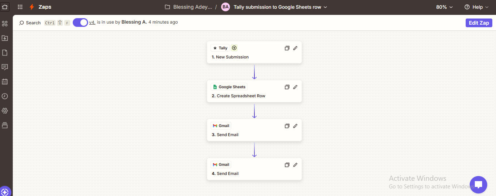
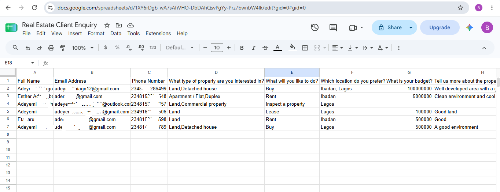
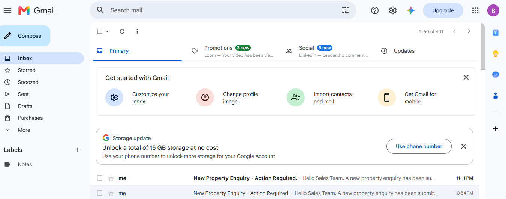

# Real Estate Property Enquiry Automation

## Project Overview
This project automates the process of capturing and managing real estate property enquiries.

The workflow collects customer information through a Tally form, stores the submitted details in Google Sheets, sends an acknowledgement email to the client, and notifies the sales representative through Gmail.

## Business Problem
Real estate businesses can lose potential customers when enquiries are handled manually. Manual data entry can also cause delays, disorganised records, and missed follow-ups.

## Solution
This automation streamlines lead capture and notification, helping businesses organise incoming enquiries and respond to potential clients more efficiently.

## Tools Used
- **Tally:** Collects property enquiries through an online form.
- **Zapier:** Connects the applications and automates the workflow.
- **Google Sheets:** Stores submitted lead information.
- **Gmail:** Sends acknowledgement emails to clients and notifications to sales representatives.

## Workflow Process
1. A potential customer submits a property enquiry through the Tally form.
2. **Zapier** receives the form submission and triggers the automation.
3. The customer's information is automatically added to the Google Sheets.
4. An acknowledgement email is sent to the customer through Gmail.
5. A notification is sent to the sales representative for follow-up through Gmail.

## Skills Demonstrated
- Workflow automation
- Lead capture and management
- Form integration
- Google Sheets integration
- Email automation
- Business process improvement

## Project Objective
To demonstrate how no-code automation can simplify lead management, reduce repetitive administrative tasks, and improve response times for real estate businesses.

### 1. Zapier Workflow
This shows how the application connects to automate lead capture.

### 2. Google Sheet Results
This demonstrate how property enquiries are stored automatically.

### 3. Sales Representative Notification
This demonstrate the email notification sent to the sales representative.

## Author
**Adeyemiblessingolarewaju**

GitHub: [adeyemiblessingolarewaju](https://github.com/adeyemiblessingolarewaju)
